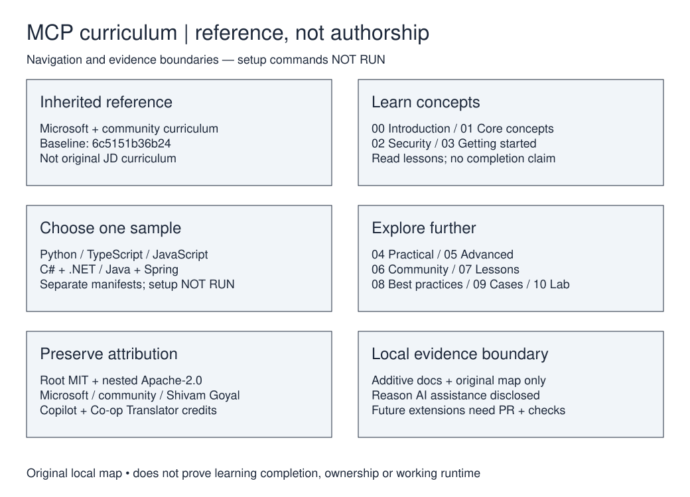

# Local reference guide and provenance ledger

## Purpose and classification

Retain this repository as **reference / curriculum** (high confidence), not as an
original JD showcase application. It teaches Model Context Protocol concepts,
servers, clients, security and integrations through Python, TypeScript/JavaScript,
C#/.NET and Java/Spring examples. Namespace alone establishes neither authorship
nor GitHub fork status, nor evidence of completed learning.

The refreshed default branch `main` was
`6c5151b36b243c2b1db77174b118ce3bf02b5f5e` before these additive documents.
The inherited [root README](../../README.md) explicitly links Microsoft's curriculum;
the [same commit is available upstream](https://github.com/microsoft/mcp-for-beginners/commit/6c5151b36b243c2b1db77174b118ce3bf02b5f5e).
[This copy's pinned source](https://github.com/JDKristenson/mcp-for-beginners/tree/6c5151b36b243c2b1db77174b118ce3bf02b5f5e)
is the evidence baseline, not a promise of parity with today's upstream head.
The prior source audit found no tree difference at that upstream commit.
Actual GitHub fork metadata remains unverified.

The non-shallow baseline default history contains 769 commits, with recorded
committer dates from April 4 through July 31, 2025. These are inherited repository
activity, not JD learning or contribution dates. The bounded prior author-name
review did not identify Kristenson/JDKristenson; that does **not** prove zero
contributions through aliases, upstream work, other branches or private exercises.
No JD-specific implementation is established by the reviewed baseline. No course
completion, production deployment, working setup or current dependency compatibility
is asserted. No tracked repository instruction file was found in the refreshed baseline.

## Attribution and license boundaries

- Preserve Microsoft's [root MIT license](../../LICENSE), copyright and permission
  notice. This document does not replace any existing grant or notice.
- Four Java samples carry Apache-2.0 licenses: [first server](../../03-GettingStarted/01-first-server/solution/java/LICENSE),
  [client](../../03-GettingStarted/02-client/solution/java/LICENSE),
  [LLM client](../../03-GettingStarted/03-llm-client/solution/java/LICENSE) and
  [calculator](../../03-GettingStarted/samples/java/calculator/LICENSE).
  The licenses credit the Spring AI MCP Echo Server Sample; Maven wrapper sources
  retain additional third-party notices. Do not describe the whole tree as exclusively MIT.
  Redistribution must preserve applicable licenses, attribution and notices;
  Apache-covered modifications require appropriate modification notices. No separately
  named NOTICE file was found in the baseline tracked-path inventory.
- Preserve the root README's Shivam Goyal/community credit, historical contributors,
  and existing Copilot/coauthor trailers. Preserve Co-op Translator's AI-generated
  translation attribution and disclaimer, including the [English translation](../../translations/en/README.md).
- Existing Microsoft trademark, CLA, security and support text is inherited policy,
  not proof that Microsoft manages, endorses or supports this repository copy.
- This is document-level evidence, not comprehensive legal clearance for dependencies,
  illustrations, compatibility or every contributor's rights.

## Sample-specific setup — inferred, NOT RUN

There is no single root build established here. Choose **one** sample and read its
own guide and manifest before executing anything. These commands are documentation
inferences from the pinned baseline, not successful verification. No installation,
build, test, server, inspector, external API or credential probe was run for this cleanup.
Historical SDK ranges and snapshot dependencies may no longer resolve or interoperate.

### TypeScript first server

Sources: [sample guide](../../03-GettingStarted/01-first-server/solution/typescript/README.md)
and [package scripts](../../03-GettingStarted/01-first-server/solution/typescript/package.json).
Requires Node.js/npm; no exact supported Node version is established by this sample.
From the repository root, the documented sequence is:

```bash
cd 03-GettingStarted/01-first-server/solution/typescript
npm install
npm run build
```

**Important:** `build` is `tsc && node ./build/index.js`: it compiles **and starts
the server**, not a build-only check. `npm run inspector` invokes an inspector
that launches `node build/index.js`; do not assume it attaches to a separately
running stdio process. It may download tooling. The sample's `nnpx` invocation
is a documentation typo; the executable is `npx`. Nothing here validates inspector
compatibility or tool output.

### Python first server

Sources: [sample guide](../../03-GettingStarted/01-first-server/solution/python/README.md)
and [server](../../03-GettingStarted/01-first-server/solution/python/server.py).
Use Python with venv/pip; the sample does not establish a precise minimum version.
The following shell-specific activation guidance corrects the inherited `Scrips` typo:

```bash
cd 03-GettingStarted/01-first-server/solution/python
python -m venv venv
# POSIX shell only:
. venv/bin/activate
# Windows PowerShell alternative (instead of the line above):
# .\venv\Scripts\Activate.ps1
python -m pip install "mcp[cli]"
mcp run server.py
```

`mcp dev server.py` is the documented development/inspector route, not a unit-test
command. It can launch processes/download tools; it was not run.

### C#/.NET first server

Sources: [sample guide](../../03-GettingStarted/01-first-server/solution/dotnet/README.md)
and [project](../../03-GettingStarted/01-first-server/solution/dotnet/dotnet.csproj).
The project targets .NET 9 and uses floating package versions.

```bash
cd 03-GettingStarted/01-first-server/solution/dotnet
dotnet restore
dotnet run
```

The documented inspector route `npx @modelcontextprotocol/inspector dotnet run`
requires Node/npm in addition to .NET and launches the sample. It is not a
successful test result or evidence that separate server terminals are needed.

### Java first server

Sources: [sample guide](../../03-GettingStarted/01-first-server/solution/java/README.md)
and [Maven project](../../03-GettingStarted/01-first-server/solution/java/pom.xml).
The project specifies Java 21, Spring Boot 3.5.0 and a Spring AI snapshot BOM.
The POSIX-shell commands below come from that guide:

```bash
cd 03-GettingStarted/01-first-server/solution/java
./mvnw clean install -DskipTests
java -jar target/calculator-server-0.0.1-SNAPSHOT.jar
```

The build **skips tests** and may download Maven/dependencies. A successful package
would not prove test passage. The guide then describes an SSE inspector connection;
no server endpoint was probed here. Do not assume the same transport/setup applies
to the other language samples. Windows uses the Maven wrapper's platform-specific
entry point; its behavior was not verified.

For other samples, follow their own manifests and lesson guides rather than copying
these commands globally. Keep credentials out of tracked files and diagrams; review
network access, tool permissions and costs before running integrations. This is generic
privacy guidance, not a credential scan or a claim of safety.

## Editable curriculum map



Open [curriculum-map.excalidraw](curriculum-map.excalidraw) in Excalidraw to edit
individual text and shapes. This is an original navigation map for this cleanup,
not a copied upstream illustration or an implementation/runtime diagram. It separates
inherited curriculum, language samples and prospective evidence-backed local work.
The SVG is generated from those same elements with the standard-library-only
[renderer](render_map.py). To regenerate the preview (documentation tooling only):

```bash
python docs/portfolio/render_map.py
```

The renderer supports this map's rectangles and text, not arbitrary Excalidraw
features. Preserve its font/geometry conventions or extend it deliberately when editing.
Source/SVG label and geometry parity and a rendered preview were checked; native
Excalidraw import/edit/export was not exercised. No application execution is implied.

## Local-work ledger

### Additive portfolio documentation cleanup

- **Change:** root reference banner, this guide and ledger, original editable map,
  matching SVG and its deterministic renderer. No sample implementation is claimed.
- **Credit:** prepared with Reason AI assistance for JD's portfolio organization;
  this does not attribute inherited curriculum or code to JD or Reason.
- **Evidence:** baseline pinned above; the delivery PR and Git history record the
  eventual publication date and changed files. No earlier JD activity is invented.
- **Checks:** static source/link checks, README-prefix preservation, unchanged baseline
  tree outside README, diagram JSON/XML and label/geometry parity, deterministic SVG,
  and rendered visual inspection. Check results belong in the delivery PR, not a
  claim that sample setup/build/test passed.
- **Not run:** curriculum installation/build/tests, server/inspector/API execution,
  authentication, deployment or native Excalidraw round-trip.

For future genuine local work, add an entry with purpose, changed paths, commit/PR,
author/collaborator/AI attribution, commands actually run and decisive results,
remaining gaps and license obligations. Link extensions separately as showcase
candidates only once their specific original contribution and checks are evidenced.

Retain as reference now. Archive/delete recommendations require additional intent,
dependency and inactivity evidence plus the owner's consequential decision; no
repository state or visibility change is part of this documentation cleanup.
